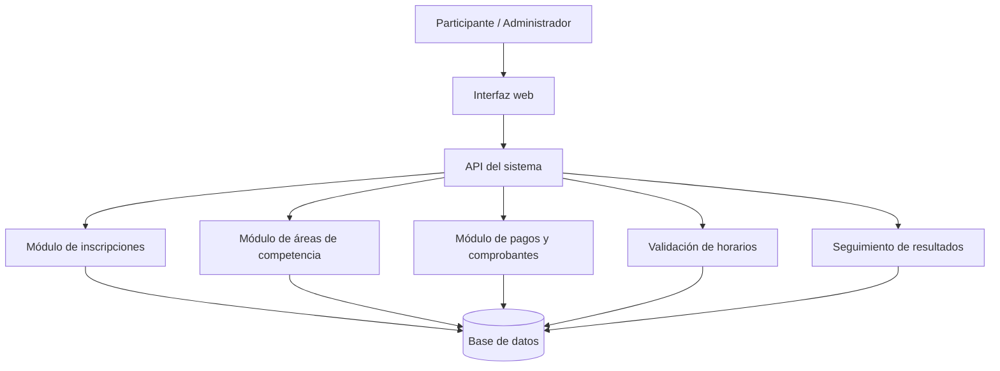

# Arquitectura del Sistema

## Visión general

## Componentes principales

## Diagrama de arquitectura

## Tecnologías utilizadas

| Componente | Tecnología | Versión | Justificación |
|---|---|---|---|
| | | | |

## Decisiones de diseño

### Decisión 1
**Contexto:**
**Decisión:**
**Consecuencias:**

## Flujo de datos